

 
 
 
 

 
<a href="https://github.com/Ajimimahdi16/GestionaleAutodemolizione"></a> 
 

 
<a href="https://autodemolizionericambitorino.it"></a> 
 

 
<a href="https://arrowfc.it"></a> 
 

 
 

 
<a href="https://www.linkedin.com/in/mahdi-ajimi-07589b249"></a><a href="mailto:ajimimahdi1@gmail.com"></a><a href="https://github.com/Ajimimahdi16"></a>

